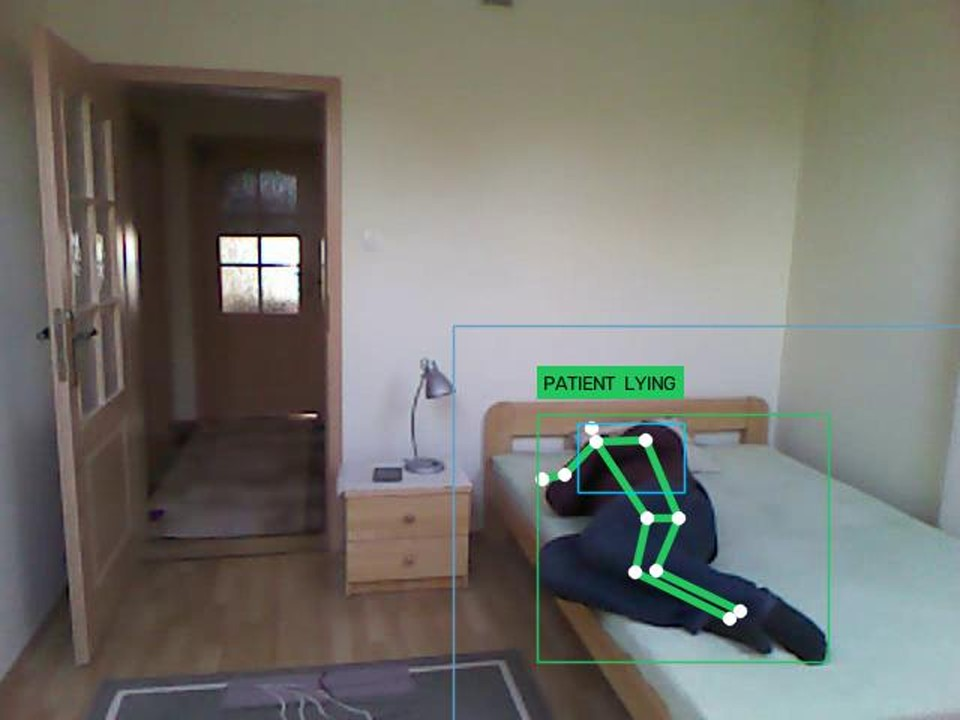

# Patient-Monitoring

Contactless bed monitoring with one camera. Breathing rate, heart rate (rPPG), falls, bed exit,
posture, hand signs. Runs on a laptop CPU, stores numbers only, no video.

I built this for Alte University’s MedTech Hackathon, sponsored by Tbilisi Medic, for students in grades 10–12. It didn’t make the top 10, and honestly, I’m still fucking confused. From what I saw, teams with a patient–doctor messaging app and an Arduino delivery car made it through. Obviously I’m biased because I built this thing, but I thought it deserved a shot. Anyway, here’s the project. Try it, judge it for yourself, and maybe I’ll have better luck next time.



<sub>Frame from UR Fall Detection Dataset (Kwolek & Kepski 2014, CC BY-NC-SA 4.0) run through the pipeline.</sub>

**Not a medical device.** See [docs/validation.md](docs/validation.md) for what was tested and how.


## Run

```bash
pip install -r requirements.txt
python tools/get_models.py
python tools/optimize_models.py   # optional, openvino, ~2x faster on intel

python run.py                                 # webcam
python run.py --source onvif://192.168.1.50   # ip camera
python run.py --source clip.mp4 --sim-beds 4
```

Open http://localhost:8000. Other pages: `/nurse`, `/bedside/bed1`, `/report/bed1`, `/analytics`, `/evidence`.
`python run.py -h` for flags (`--profile clinical`, `--privacy`, `--access-code`, `--ntfy-topic`, ...).

## Notes

- Camera from the side, whole body in frame. Breathing only starts once shoulders and hips are visible.
- Wi-Fi cameras stall a lot on 1080p. Use a cable, or the sub stream (`onvif://ip/sub`).
- Passwords: put `{password}` in the rtsp url, it asks at start (or `CAMERA_PASSWORD`).
- Optional assistant (handover text, questions) with Gemini on Vertex or Claude. Only sees numbers.

## Layout

```
monitor/capture.py      camera thread
monitor/pose.py         yolo11n-pose + bytetrack
monitor/signals/        breathing (optical flow), rppg
monitor/events/         posture/falls, hands, face, baseline/risk, sleep
monitor/bed.py          per-bed pipeline
monitor/server.py       fastapi, web/ is plain html+js
cloud.py                optional relay
```

## Tests

```bash
python -m unittest discover -s tests -p "test_*.py"
```

## License

AGPL-3.0 (Ultralytics YOLO is AGPL).

## Personal Note

I built this project for **Alte University's MedTech Hackathon**, sponsored by **Tbilisi Medic**. The competition was intended for students in grades 10–12, and the organizers announced that they would select the 10 best teams.

Unfortunately, I didn’t qualify for the top 10. But you know what? After discovering a few interesting things about their security, I started wondering whether they’d qualify for the RaidForums or BreachForums.

But before we get into that, let me tell you something funny about the university that organized this hackathon and the company that sponsored it.

Yo, bro, imagine organizing a technology hackathon while your own university's student portal supposedly has some of the most questionable security imaginable.
Imagine students using their personal identification numbers as both their usernames and passwords. And imagine an IDOR vulnerability that could expose other students' personal information because the system doesn't properly verify who's allowed to access what. Like, bro, we're hosting a MedTech hackathon, but who's organizing a hackathon to fix the university's own software? 

And then there's "Tbilisi Medic", the sponsor. Imagine signing up for a regular account on a platform and somehow discovering that its authorization system could let an ordinary user obtain SuperAdmin privileges. Bro, I came to participate in a hackathon, not to audition for the security team. LMAOO

Anyway, back to the actual hackathon.

The organizers said they would select the 10 best teams, and somehow, my project didn't make the cut. And you know what's even funnier? As far as I know, at least two of the teams that got selected built the following:

The first team built a messaging app for patients and doctors. Like, bro, what's the fucking point? We already have WhatsApp and Messenger. Why are we reinventing something that literally everyone already uses?

The second team built a fucking Arduino-powered car that delivers stuff to doctors. Basically, a nurse puts something on the car, and it drives over to the doctor.

Like, bro, are we seriously reinventing walking now? 💀

And somehow, my project didn't qualify for the top 10 while those projects did? I genuinely have no fucking clue what the judges were looking for. And keep in mind, this was a hackathon for 10th–12th graders. I'm not saying everyone else built garbage, but come on, man. How the fuck did I not make it into the top 10?

Maybe my mistake was building Patient-Monitoring instead of another messaging app or a remote-controlled delivery car. 

Anyway, maybe I'll have better luck next time.

Or maybe I'll just build WhatsApp 2.0 and put some wheels on it.
