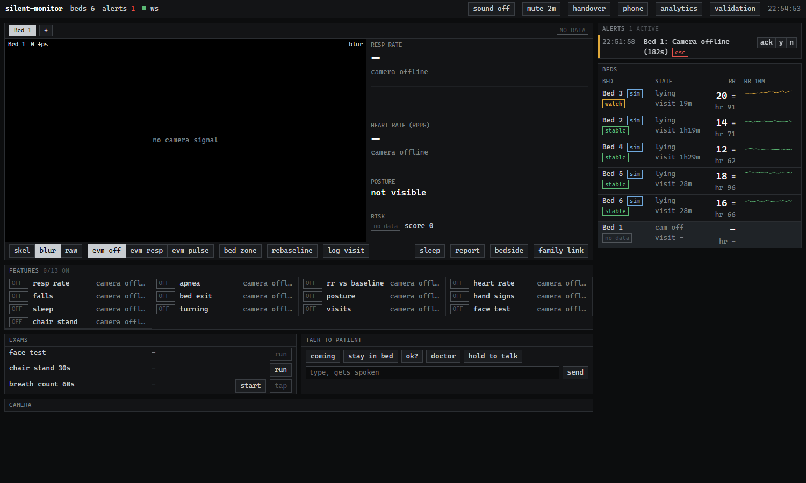

# Patient-Monitoring

Contactless bed monitoring with one camera. Breathing rate, heart rate (rPPG), falls, bed exit,
posture, hand signs. Runs on a laptop CPU, stores numbers only, no video.

I built this for Alte University’s MedTech Hackathon, sponsored by Tbilisi Medic, for students in grades 10–12. It didn’t make the top 10, and honestly, I’m still fucking confused. From what I saw, teams with a patient–doctor messaging app and an Arduino delivery car made it through. Obviously I’m biased because I built this thing, but I thought it deserved a shot. Anyway, here’s the project. Try it, judge it for yourself, and maybe I’ll have better luck next time.


<sub>Frame from UR Fall Detection Dataset (Kwolek & Kepski 2014, CC BY-NC-SA 4.0) run through the pipeline.</sub>

**Not a medical device.** See [docs/validation.md](docs/validation.md) for what was tested and how.



## Run

```bash
pip install -r requirements.txt
python tools/get_models.py
python tools/optimize_models.py   # optional, openvino, ~2x faster on intel

python run.py                                 # webcam
python run.py --source onvif://192.168.1.50   # ip camera
python run.py --source clip.mp4 --sim-beds 4
```

Open http://localhost:8000. Other pages: `/nurse`, `/bedside/bed1`, `/report/bed1`, `/analytics`, `/evidence`.
`python run.py -h` for flags (`--profile clinical`, `--privacy`, `--access-code`, `--ntfy-topic`, ...).

## Notes

- Camera from the side, whole body in frame. Breathing only starts once shoulders and hips are visible.
- Wi-Fi cameras stall a lot on 1080p. Use a cable, or the sub stream (`onvif://ip/sub`).
- Passwords: put `{password}` in the rtsp url, it asks at start (or `CAMERA_PASSWORD`).
- Optional assistant (handover text, questions) with Gemini on Vertex or Claude. Only sees numbers.

## Layout

```
monitor/capture.py      camera thread
monitor/pose.py         yolo11n-pose + bytetrack
monitor/signals/        breathing (optical flow), rppg
monitor/events/         posture/falls, hands, face, baseline/risk, sleep
monitor/bed.py          per-bed pipeline
monitor/server.py       fastapi, web/ is plain html+js
cloud.py                optional relay
```

## Tests

```bash
python -m unittest discover -s tests -p "test_*.py"
```

## License

AGPL-3.0 (Ultralytics YOLO is AGPL).
